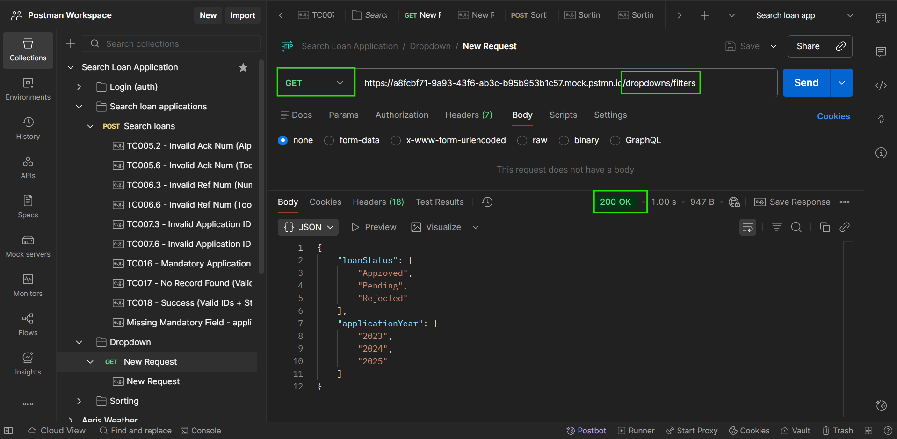

# Endpoint reference (detailed)

Before a user can search or filter loan applications in the dashboard, the frontend application calls this endpoint to populate the filter menus. It returns the pre-defined reference options for loan status flags and submission years.

## Dropdown options
- **URL:** `/dropdown/filters`  
- **Method:** `GET`  
- **Authentication:** `Bearer <token>` (JWT) required in `Authorization` header
- **Content-Type:** `application/json`
- **Description:** This API will returns the loan application status and application year dropdown options that is available in the search filter. Positive case returns 200 OK.

<swagger-ui src="https://sheethalu.github.io/Documentation-Portal/swagger.yaml" filter="Dropdown"></swagger-ui>

## DROPDOWN API – SCHEMAS

**Model: Dropdown Response**

| Field           | Type                   | Description                     |
| --------------- | ---------------------- | ------------------------------- |
| loanStatus      | array<LoanStatus>      | List of Loan application status |
| applicationYear | array<ApplicationYear> | List of application year        |

**Dropdown Response**

```yaml

loanStatus: `array<LoanStatus>`  
applications: `array<ApplicationYear>`

```

### Example

**Response:**
```json
{
  "loanStatus": ["Approved", "Pending", "Rejected"],
  "applicationYear": ["2023", "2024", "2025"]
}
```
