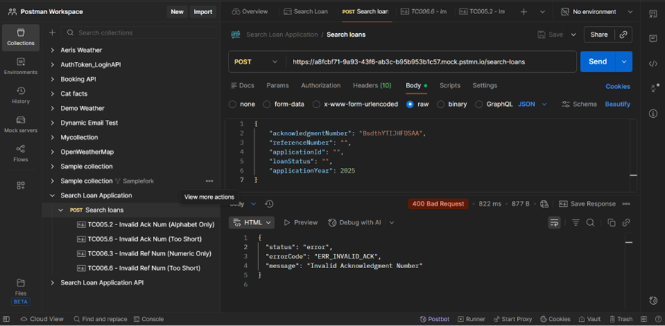
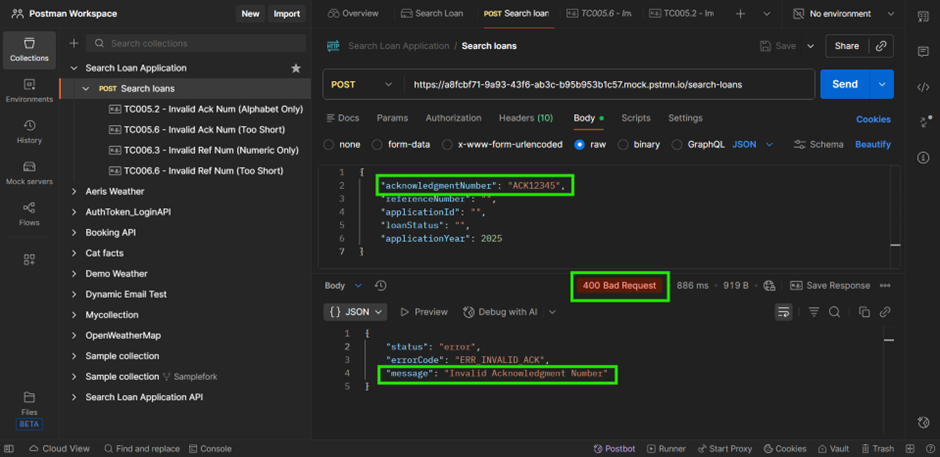
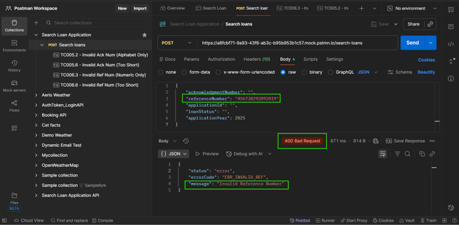
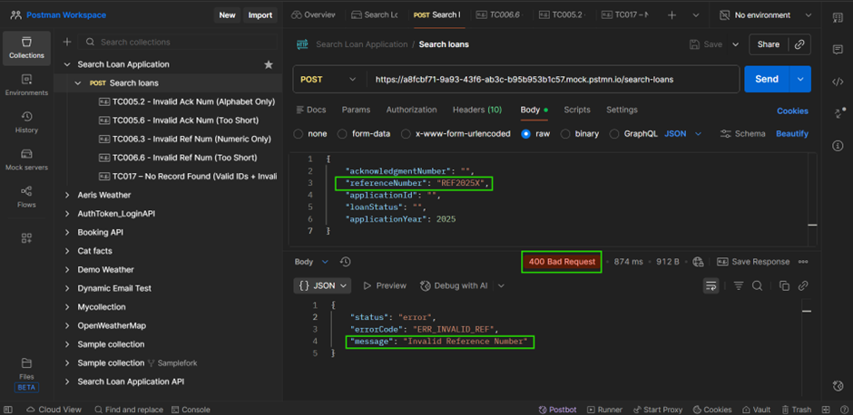
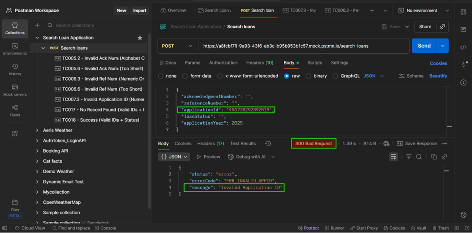
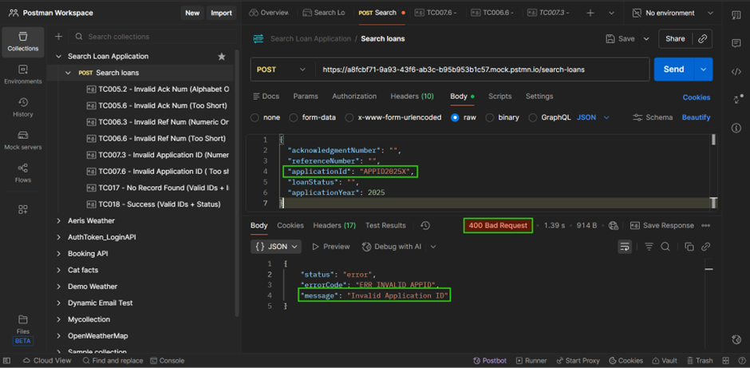
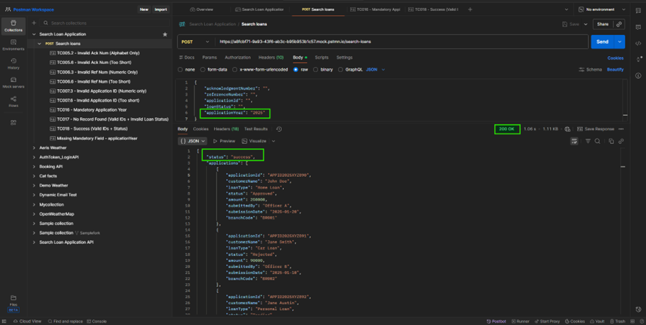
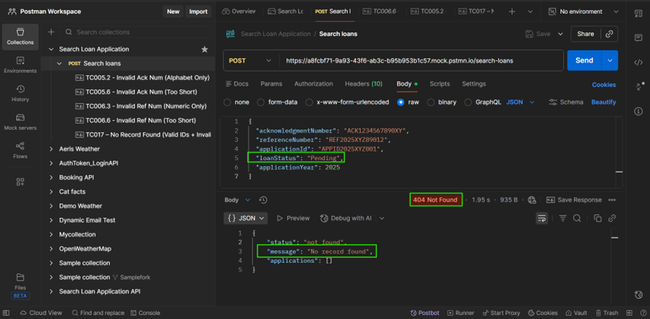
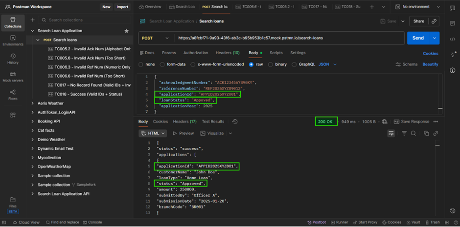
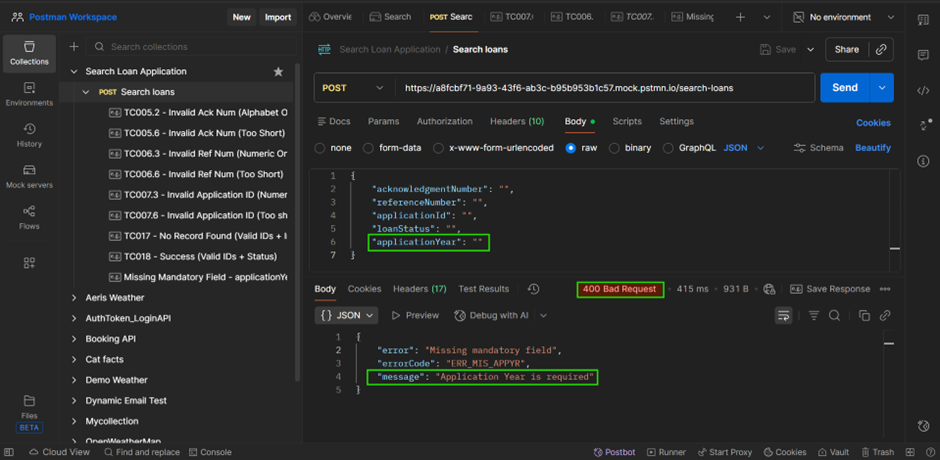

# Endpoint reference (detailed)

This endpoint helps loan staff find application records using relevant filters and sorting options. It supports reviewing applications by acknowledgment number, application ID, status, reference number, and application year. Staff can sort the results by submission date, amount, or customer name in ascending or descending order. These search and sorting capabilities help staff compare records and complete loan review workflows efficiently.

## Search loan applications
- **URL:** `/search-loans`
- **Method:** `POST`
- **Authentication:** `Bearer <token>` (JWT) required in the `Authorization` header
- **Content-Type:** `application/json`
- **Description:** Searches loan applications using request-body filters and optional query parameters. Returns `200 OK` with matching records, `400 Bad Request` for invalid input, or `404 Not Found` when no records match.

<swagger-ui src="https://sheethalu.github.io/Documentation-Portal/swagger.yaml" filter="Search"></swagger-ui>

## SEARCH API – SCHEMAS

**Model: SearchRequest**

| Field                | Type    | Required | Constraints                              | Description                         |
| -------------------- | ------- | -------- | ---------------------------------------- | ----------------------------------- |
| acknowledgmentNumber | string  | No       | 1–15 alphanumeric, case-insensitive                    | Acknowledgment number filter.       |
| applicationID           | string  | No       | 1–15 alphanumeric, case-insensitive     | Application ID filter.                 |
| referenceNumber      | string  | No       | 1–15 alphanumeric, case-insensitive         | Reference number filter.            |
| applicationYear      | integer | Yes      | `2024`, `2025`, or `2026`; default `2026` | Application year filter.           |
| loanStatus           | string  | No       | `Approved`, `Pending`, or `Rejected`     | Loan status filter.                 |

**SearchRequest**

acknowledgmentNumber: `string (1–15 alphanumeric)`  
referenceNumber: `string (1–15 alphanumeric)`  
applicationId: `string (1–15 alphanumeric)`  
loanStatus: `string (enum: Approved, Pending, Rejected)`  
applicationYear: `number (required, enum: 2024 | 2025 | 2026; default=2026)`  

**Query parameters**

| Parameter | Type   | Required | Constraints                                      | Description                |
| --------- | ------ | -------- | ------------------------------------------------ | -------------------------- |
| sortBy    | string | No       | `submissionDate`, `amount`, or `customerName`    | Field used to sort results. |
| sortOrder | string | No       | `asc` or `desc`; default `desc`                  | Sort direction.             |

**Model: SearchResponse**

| Field        | Type                     | Description                                  |
| ------------ | ------------------------ | -------------------------------------------- |
| status       | string                   | Search result status.                         |
| applications | array<ApplicationRecord> | Matching loan application records.           |

**SearchResponse**
```json
status: `string`
applications: `array<ApplicationRecord>`
```

**Model: ApplicationRecord**

| Field          | Type   | Description                                |
| -------------- | ------ | ------------------------------------------ |
| applicationId  | string | Unique loan application identifier.         |
| customerName   | string | Customer’s full name.                       |
| loanType       | string | Type of loan.                               |
| status         | string | Current application status.                 |
| amount         | number | Loan amount requested or approved.          |
| submittedBy    | string | Officer who submitted the application.      |
| submissionDate | string | Submission date in `YYYY-MM-DD` format.     |
| branchCode     | string | Branch identifier.                          |

**ApplicationRecord**

```json
applicationId: `string`
customerName: `string`
loanType: `string`
status: `string`
amount: `number`
submittedBy: `string`
submissionDate: `string (date)`
branchCode: `string`
```

### Scenario A:  Search-loan

The following section details the validated test scenarios for the loan search and filtering endpoint, including request payloads, response codes, and verified results..

**TC005.2 - Invalid Ack Num (Alphabet Only)**

**Request:**
```json
{
    "acknowledgementNumber": "BsdthYTIJHFDSAA",
    "referenceNumber": "",
    "applicationId": "",
    "loanStatus": "",
    "applicationYear": 2025
}
``
**Response: `400 Bad Request`**
```json
{
  "status": "error",
  "errorCode": "ERR_INVALID_ACK",
  "message": "Invalid Acknowledgment Number"
}
```


**TC005.6 – Acknowledgment number shorter than 15 characters**

**Request:**
```json
{
    "acknowledgementNumber": "ACK12345",
    "referenceNumber": "",
    "applicationId": "",
    "loanStatus": "",
    "applicationYear": 2025
}
```
**Response: `400 Bad Request`**
```json
{
  "status": "error",
  "errorCode": "ERR_INVALID_ACK",
  "message": "Invalid Acknowledgment Number"
}
```


**TC006.3 - Invalid Ref Num (Numeric Only)**

**Request**
```json
{
    "acknowledgementNumber": "",
    "referenceNumber": "456738292892019",
    "applicationId": "",
    "loanStatus": "",
    "applicationYear": 2025
}
```
**Response: `400 Bad Request`**
```json
{
  "status": "error",
  "errorCode": "ERR_INVALID_REF",
  "message": "Invalid Reference Number"
}
```


**TC006.6 - Invalid Ref Num (Too Short)**

**Request**
```json
{
    "acknowledgementNumber": "",
    "referenceNumber": "REF2025X",
    "applicationId": "",
    "loanStatus": "",
    "applicationYear": 2025
}
```
**Response: `400 Bad Request`**
```json
{
  "status": "error",
  "errorCode": "ERR_INVALID_REF"
  "message": "Invalid Reference Number"
}
```


**TC007.3 - Invalid Application ID (Numeric only)**

**Request:**
```json
{
  "acknowledgementNumber": "",
  "referenceNumber": "",
  "applicationId": "456738292892019",
  "loanStatus": "",
  "applicationYear": 2025
}
```
**Response: `400 Bad Request`**
```json
{
  "status": "error",
  "errorCode": "ERR_INVALID_APPID",
  "message": "Invalid Application ID"
}
```


**TC007.6 - Invalid Application ID (Too short)**

**Request:**
```json
{
  "acknowledgementNumber": "",
  "referenceNumber": "",
  "applicationId": "APPID2025X",
  "loanStatus": "",
  "applicationYear": 2025
}
```
**Response: `400 Bad Request`**
```json
{
  "status": "error",
  "errorCode": "ERR_INVALID_APPID",
  "message": "Invalid Application ID"
}
```


**TC016 - Mandatory Application Year**

**Request:**
```json
{
    "acknowledgementNumber": "",
    "referenceNumber": "",
    "applicationId": "",
    "loanStatus": "",
    "applicationYear": "2025"
}
```
**Response: `200 OK`**
```json
{
  "status": "success",
  "applications": [
    {
      "applicationId": "APPID2025XYZ890",
      "customerName": "John Doe",
      "loanType": "Home Loan",
      "status": "Approved",
      "amount": 250000,
      "submittedBy": "Officer A",
      "submissionDate": "2025-01-20",
      "branchCode": "BR001"
    },
    {
      "applicationId": "APPID2025XYZ891",
      "customerName": "Jane Smith",
      "loanType": "Car Loan",
      "status": "Rejected",
      "amount": 90000,
      "submittedBy": "Officer B",
      "submissionDate": "2025-01-10",
      "branchCode": "BR002"
    },
    {
      "applicationId": "APPID2025XYZ892",
      "customerName": "Jane Austin",
      "loanType": "Personal Loan",
      "status": "Pending",
      "amount": 90000,
      "submittedBy": "Officer B",
      "submissionDate": "2025-01-11",
      "branchCode": "BR002"
    }
  ]
}
```


**TC017 – No Record Found (Valid IDs + Invalid Loan Status)**

**Request:**
```json
{
  "acknowledgementNumber": "ACK1234567890XY",
  "referenceNumber": "REF2025XYZ89012",
  "applicationId": "APPID2025XYZ001",
  "loanStatus": "Pending",
  "applicationYear": 2025
}
```
**Response: `404 Not Found`**
```json
{
  "status": "not_found",
  "message": "No record found",
  "applications": []
}
```


**TC018 - Success (Valid IDs + Status)**

**Request:**
```json
{
  "acknowledgementNumber": "ACK1234567890XY",
  "referenceNumber": "REF2025XYZ89012",
  "applicationId": "APPID2025XYZ001",
  "loanStatus": "Appoved",
  "applicationYear": 2025
}
```
**Response: `200 OK`**
```json
{
  "status": "success",
  "applications": [
    {
      "applicationId": "APPID2025XYZ001",
      "customerName": "John Doe",
      "loanType": "Home Loan",
      "status": "Approved",
      "amount": 250000,
      "submittedBy": "Officer A",
      "submissionDate": "2025-01-20",
      "branchCode": "BR001"
    }
  ]
}
```


**Missing Mandatory Field - applicationYear**

**Request:**
```json
{
    "acknowledgementNumber": "",
    "referenceNumber": "",
    "applicationId": "",
    "loanStatus": "",
    "applicationYear": ""
}
```
**Response:**
```json
{
  "error": "Missing mandatory field",
  "errorCode": "ERR_MIS_APPYR",
  "message": "Application Year is required"
}
```


### Scenario B:  Sorting

The examples below demonstrate how sorting query parameters (sortBy and sortOrder) alter the returned data set. Included are representative JSON request payloads, expected `200 OK` responses showing results ordered in ascending (asc) and descending (desc) sequence.

**Sorting - Descending**

**Request URL:** `/search-loans?sortBy=submissionDate&sortOrder=desc`

**Request:**
```json
{
    "acknowledgementNumber": "",
    "referenceNumber": "",
    "applicationId": "",
    "loanStatus": "",
    "applicationYear": "2025"
}
```
**Response:**
```json
{
  "status": "success",
  "applications": [
    {
      "applicationId": "APPID2025XYZ892",
      "customerName": "Jane Austin",
      "loanType": "Personal Loan",
      "status": "Pending",
      "amount": 90000,
      "submittedBy": "Officer B",
      "submissionDate": "2025-09-11",
      "branchCode": "BR002"
    },
      {
      "applicationId": "APPID2025XYZ891",
      "customerName": "Jane Smith",
      "loanType": "Car Loan",
      "status": "Rejected",
      "amount": 90000,
      "submittedBy": "Officer B",
      "submissionDate": "2025-06-10",
      "branchCode": "BR002"
    },
    {
      "applicationId": "APPID2025XYZ890",
      "customerName": "John Doe",
      "loanType": "Home Loan",
      "status": "Approved",
      "amount": 250000,
      "submittedBy": "Officer A",
      "submissionDate": "2025-01-20",
      "branchCode": "BR001"
    }
  ]
}

```

**Sorting - Ascending**

**Request URL:** `/search-loans?sortBy=submissionDate&sortOrder=asc`

**Request:**
```json
{
    "acknowledgementNumber": "",
    "referenceNumber": "",
    "applicationId": "",
    "loanStatus": "",
    "applicationYear": "2025"
}
```
**Response:**
```json
{
  "status": "success",
  "applications": [
    {
      "applicationId": "APPID2025XYZ890",
      "customerName": "John Doe",
      "loanType": "Home Loan",
      "status": "Approved",
      "amount": 250000,
      "submittedBy": "Officer A",
      "submissionDate": "2025-01-20",
      "branchCode": "BR001"
    },
    {
      "applicationId": "APPID2025XYZ891",
      "customerName": "Jane Smith",
      "loanType": "Car Loan",
      "status": "Rejected",
      "amount": 90000,
      "submittedBy": "Officer B",
      "submissionDate": "2025-06-10",
      "branchCode": "BR002"
    },
    {
      "applicationId": "APPID2025XYZ892",
      "customerName": "Jane Austin",
      "loanType": "Personal Loan",
      "status": "Pending",
      "amount": 90000,
      "submittedBy": "Officer B",
      "submissionDate": "2025-09-11",
      "branchCode": "BR002"
    }
  ]
}
```